<!-- robot:start -->

   
  <b>Ascending, power level 1</b>: 28 commits in the last 7 days. No streak right now. Evolution: Scarf (75 commits in the last year). 
  This robot updates itself every day from my public GitHub activity. <a href="https://github.com/0xgui/0xgui/actions/workflows/robot.yml">See how</a>. Last changed 2026-10-17.

<!-- robot:end -->

### Building
- [SO-101](https://github.com/0xgui/SO-101), two robot arms (leader and follower) built from scratch with LeRobot
- [pico-self-rising-robot](https://github.com/0xgui/pico-self-rising-robot), a small robot that learns to stand up on its own

### Writing
- [Binary Paths](https://binarypaths.substack.com), on engineering, tech, and how AI meets the physical world
- [silvags.com](https://silvags.com)
