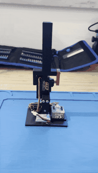
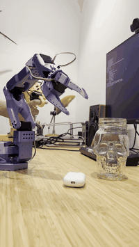
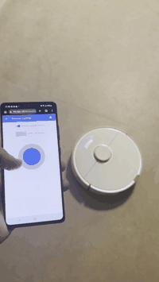

I build things across software, infrastructure, and hardware, and write about where AI meets the physical world.

  
  
  

- ✍️ Newsletter: [Binary Paths](https://binarypaths.substack.com), on engineering, tech, and AI in the physical world
- 🌐 Website: [silvags.com](https://silvags.com)
